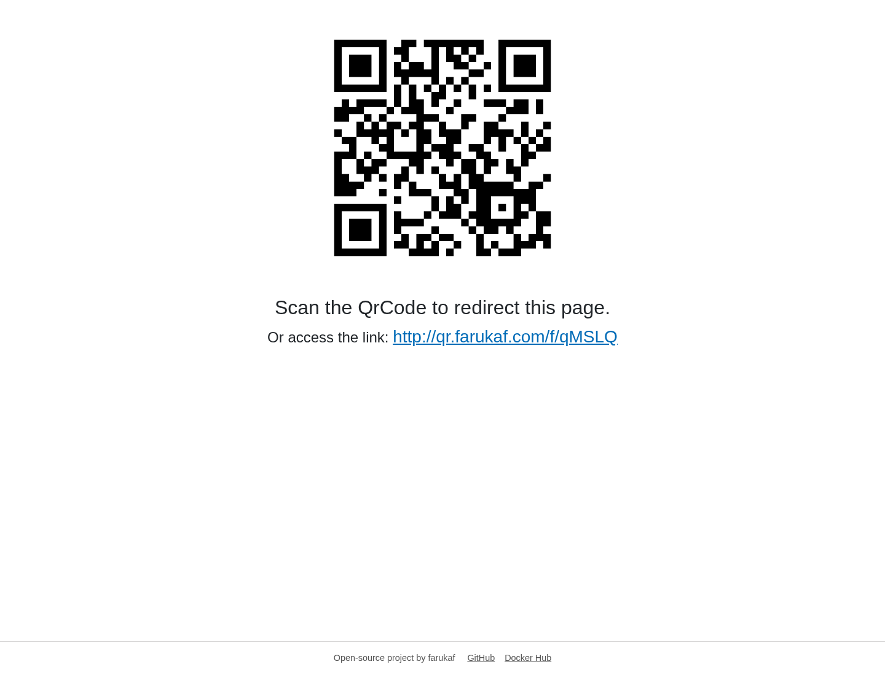

# QR Code Redirect

**Didn't read? Use it now:** [qr.farukaf.com](https://qr.farukaf.com)

Use a QR code to send a destination to a screen you cannot reach physically. QR Code Redirect shows a temporary QR code on a TV or shared display. Scan it with a phone, enter a destination website, and the browser displaying the QR code navigates there.

## Example: update a TV remotely

Imagine a TV at an event is showing a welcome screen. An organizer wants to switch it to the event schedule without using the TV remote:

1. Open QR Code Redirect in the TV's browser and leave the page open.
2. Scan the displayed QR code with a phone. It opens a small form for that screen.
3. Enter a destination, such as `https://example.com/event-schedule`, and confirm.
4. The TV browser that was displaying the QR code opens the schedule.

The QR code opens the control form; it does not encode the final destination. Each display page gets a temporary code held in the running application. Keep that page open while using it; refreshing it or restarting the app ends that redirect session.



## Run with Docker

```sh
docker run --rm -p 8080:8080 farukaf/qrcode-redirect:latest
```

Open `http://localhost:8080` in a browser. For a phone to control a TV remotely, both devices must be able to reach the same public host or network address. The QR code uses the address through which the display page was opened.

## Project

The application is built with Blazor Server on ASP.NET Core. Redirect sessions are held in memory; no external database is required.

- [Source code and issues](https://github.com/farukaf/qrcode-redirect)
- [Docker Hub image and tags](https://hub.docker.com/r/farukaf/qrcode-redirect)
